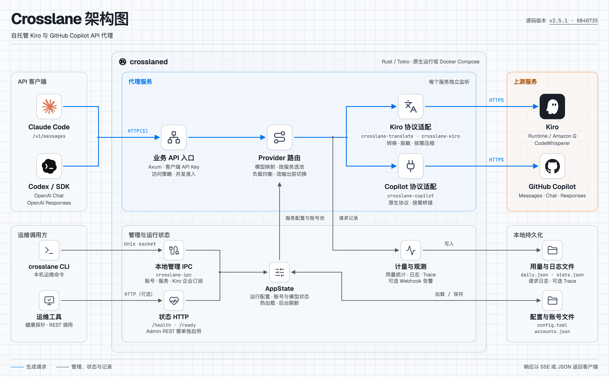

# crosslane

[](LICENSE)
[](rust-toolchain.toml)
[](docs/startup-and-debugging.zh-CN.md#docker)
[](https://github.com/Yaocool/crosslane/actions/workflows/docker-image.yml)
[](docker-compose.yml)

[English](README.md) | [简体中文](README.zh-CN.md)

Crosslane 是面向 Kiro 和 GitHub Copilot 账号的自托管 API 代理，提供 Claude Messages、
OpenAI Chat Completions、OpenAI Responses 和模型列表接口。使用 `crosslaned`
运行服务，使用 `crosslane` 管理账号、服务和日志。上游凭证与客户端 API Key 分开管理。

## ⚠️ 重要提醒

**服务条款风险：**通过代理使用 Kiro 或 GitHub Copilot，可能不符合特定账号适用的条款。
使用前请核对 [Kiro 条款说明](https://kiro.dev/downloads/)、
[AWS 服务条款](https://aws.amazon.com/service-terms/)、
[GitHub Copilot 条款](https://docs.github.com/en/site-policy/github-terms/github-terms-for-additional-products-and-features#github-copilot)
及所在组织的政策；不符合条款的使用可能导致账号受限或服务中断。

**免责声明：**本项目依据 [MIT 许可](LICENSE)按“现状”提供，不保证上游服务持续可用或账号
持续具有访问权限。使用者须自行管理凭证并对上游服务的使用负责。在适用法律允许的范围内，
维护者不对使用本项目引起的账号限制、服务中断或相关损失承担责任。

## 架构



## 快速开始

以下命令在仓库根目录执行。Linux 主机使用 Docker 时需要 Docker Engine 和 Compose：

```bash
./deploy/docker-setup.sh --build
crosslane health
```

安装脚本会提供宿主机 `crosslane` 命令，服务数据保存在 `crosslane-data` Docker 卷中。
使用可用的仓库镜像时可省略 `--build`，或用 `--image` 指定版本。升级与备份见
[运维指南](docs/startup-and-debugging.zh-CN.md#docker)。

Linux 或 macOS 本地编译需要 Rust 和 C 工具链：

```bash
cp .env.example .env
cargo build --release --locked
./target/release/crosslaned
```

另开终端，在仓库根目录执行：

```bash
export PATH="$PWD/target/release:$PATH"
crosslane health
```

示例环境将本地数据放在 `.crosslane-dev`。从不同目录运行命令时，建议使用绝对路径的
`CROSSLANE_HOME`。

## 创建服务

先按支持的方式添加 Kiro 账号。导入 headless API key 时，在 CLI 进程环境中提供
`KIRO_API_KEY`：

```bash
crosslane account add-api-key --email ci@example.com --region us-east-1
```

企业 SSO 和 GitHub Copilot 账号的添加方法见[账号配置](docs/startup-and-debugging.zh-CN.md#账号)。
然后创建监听服务，并妥善保存命令输出的客户端 Key：

```bash
crosslane service create --name main --host 127.0.0.1
crosslane account list
crosslane models list
crosslane ready
```

`health` 检查 daemon 是否响应；`ready` 检查已配置服务是否具备接收请求的条件。
还需实际发送生成请求才能验证上游可用。不要把上游凭证当作客户端 Key。

## 管理入口

CLI 通过 daemon 的 Unix socket 管理本地资源。HTTP 状态检查和可选的 Admin REST
使用独立端口，默认 `127.0.0.1:7651`，需先启用 `[status_http]`。
[Admin REST](docs/admin-rest.zh-CN.md) 使用独立管理令牌；
[Kiro 企业订阅管理](docs/kiro-enterprise-admin.zh-CN.md) 使用 daemon 保存的 AWS 凭证。
客户端 Key、Admin token 和 AWS 凭证各自独立。

## 接入客户端

| 端点 | 用途 |
| --- | --- |
| `POST /v1/messages` | Claude Messages |
| `POST /v1/messages/count_tokens` | Token 计数 |
| `POST /v1/chat/completions` | OpenAI Chat Completions |
| `POST /v1/responses` | OpenAI Responses |
| `GET /v1/models` | 可用模型 |

Claude Code 的 `ANTHROPIC_BASE_URL` 指向服务地址，例如 `http://127.0.0.1:5580`；
`ANTHROPIC_AUTH_TOKEN` 使用客户端 Key。模型从 `crosslane models list` 中选择。
其他客户端可能需要配置 User-Agent 豁免，见[客户端访问](docs/startup-and-debugging.zh-CN.md#服务与客户端访问)。
服务对本机以外开放时，应配置 TLS 并限制网络访问。

## 日常命令

```bash
crosslane status
crosslane service list
crosslane models list
crosslane stats --since 1h
crosslane logs show --tail 100
crosslane logs trace TRACE_ID
crosslane help --all
```

## 文档

| 文档 | 内容 |
| --- | --- |
| [运维指南](docs/startup-and-debugging.zh-CN.md) | 部署、账号、服务、模型、日志与备份 |
| [请求处理](docs/request-processing.zh-CN.md) | 缓存用量、工具加载、延迟、脱敏与自动压缩 |
| [客户端兼容](docs/client-compatibility.zh-CN.md) | 工具协议、网页搜索、会话归属、CRS 与上游拒绝 |
| [Admin REST API](docs/admin-rest.zh-CN.md) | 管理令牌、本地账号与服务、批量操作、JSON 响应保存 |
| [Kiro 企业订阅管理](docs/kiro-enterprise-admin.zh-CN.md) | AWS 凭证、用户资料、直接/组订阅与套餐变更 |
| [贡献指南](CONTRIBUTING.md) | 开发、验证和文档维护 |

项目使用 [MIT 许可](LICENSE)。
